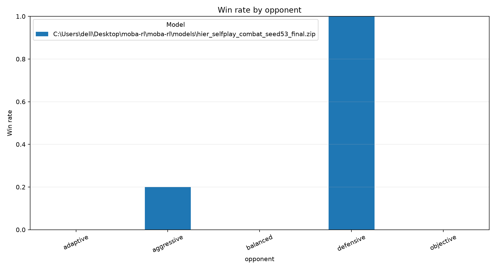

# MOBA-RL analysis report

## Evaluation summary

| model                                                                              | opponent   |   episodes |   wins |   losses |   draws |   mean_episode_length |   mean_episode_reward |   win_rate |
|:-----------------------------------------------------------------------------------|:-----------|-----------:|-------:|---------:|--------:|----------------------:|----------------------:|-----------:|
| .\models\hier_selfplay_combat_seed53_final.zip | adaptive   |          5 |      0 |        5 |       0 |                1108.4 |               22.074  |        0   |
| .\models\hier_selfplay_combat_seed53_final.zip | aggressive |          5 |      1 |        4 |       0 |                1444.2 |               58.0165 |        0.2 |
| .\models\hier_selfplay_combat_seed53_final.zip | balanced   |          5 |      0 |        5 |       0 |                1077.2 |               27.4813 |        0   |
| .\models\hier_selfplay_combat_seed53_final.zip | defensive  |          5 |      5 |        0 |       0 |                1287.4 |               58.9379 |        1   |
| .\models\hier_selfplay_combat_seed53_final.zip | objective  |          5 |      0 |        5 |       0 |                1103.8 |               13.0473 |        0   |

## Replay summary

| file                                     | opponent   | winner   |   episode_seed |   steps |   event_count |   objective_captures |   blue_objective_captures |   red_objective_captures |
|:-----------------------------------------|:-----------|:---------|---------------:|--------:|--------------:|---------------------:|--------------------------:|-------------------------:|
| adaptive_episode_0000_seed_170000.json   | adaptive   | red      |         170000 |    1151 |           827 |                    1 |                         1 |                        0 |
| adaptive_episode_0001_seed_170001.json   | adaptive   | red      |         170001 |    1116 |           813 |                    1 |                         1 |                        0 |
| adaptive_episode_0002_seed_170002.json   | adaptive   | red      |         170002 |    1087 |           731 |                    1 |                         0 |                        1 |
| adaptive_episode_0003_seed_170003.json   | adaptive   | red      |         170003 |    1086 |           736 |                    1 |                         0 |                        1 |
| adaptive_episode_0004_seed_170004.json   | adaptive   | red      |         170004 |    1102 |           711 |                    1 |                         1 |                        0 |
| aggressive_episode_0000_seed_130000.json | aggressive | red      |         130000 |    1414 |           923 |                    1 |                         1 |                        0 |
| aggressive_episode_0001_seed_130001.json | aggressive | red      |         130001 |    1448 |           983 |                    1 |                         1 |                        0 |
| aggressive_episode_0002_seed_130002.json | aggressive | blue     |         130002 |    1487 |           970 |                    2 |                         2 |                        0 |
| aggressive_episode_0003_seed_130003.json | aggressive | red      |         130003 |    1481 |           969 |                    1 |                         1 |                        0 |
| aggressive_episode_0004_seed_130004.json | aggressive | red      |         130004 |    1391 |           957 |                    1 |                         1 |                        0 |
| balanced_episode_0000_seed_160000.json   | balanced   | red      |         160000 |    1085 |           620 |                    1 |                         1 |                        0 |
| balanced_episode_0001_seed_160001.json   | balanced   | red      |         160001 |    1094 |           633 |                    1 |                         1 |                        0 |
| balanced_episode_0002_seed_160002.json   | balanced   | red      |         160002 |    1052 |           619 |                    1 |                         1 |                        0 |
| balanced_episode_0003_seed_160003.json   | balanced   | red      |         160003 |    1062 |           581 |                    1 |                         1 |                        0 |
| balanced_episode_0004_seed_160004.json   | balanced   | red      |         160004 |    1093 |           628 |                    1 |                         1 |                        0 |
| defensive_episode_0000_seed_140000.json  | defensive  | blue     |         140000 |    1276 |           706 |                    1 |                         1 |                        0 |
| defensive_episode_0001_seed_140001.json  | defensive  | blue     |         140001 |    1293 |           659 |                    1 |                         1 |                        0 |
| defensive_episode_0002_seed_140002.json  | defensive  | blue     |         140002 |    1282 |           663 |                    1 |                         1 |                        0 |
| defensive_episode_0003_seed_140003.json  | defensive  | blue     |         140003 |    1311 |           661 |                    1 |                         1 |                        0 |
| defensive_episode_0004_seed_140004.json  | defensive  | blue     |         140004 |    1275 |           670 |                    1 |                         1 |                        0 |
| objective_episode_0000_seed_150000.json  | objective  | red      |         150000 |    1180 |           881 |                    1 |                         1 |                        0 |
| objective_episode_0001_seed_150001.json  | objective  | red      |         150001 |    1079 |           701 |                    1 |                         0 |                        1 |
| objective_episode_0002_seed_150002.json  | objective  | red      |         150002 |    1085 |           753 |                    1 |                         0 |                        1 |
| objective_episode_0003_seed_150003.json  | objective  | red      |         150003 |    1100 |           742 |                    1 |                         0 |                        1 |
| objective_episode_0004_seed_150004.json  | objective  | red      |         150004 |    1075 |           725 |                    1 |                         0 |                        1 |

Action counts are also saved to `replay_action_counts.csv`.
