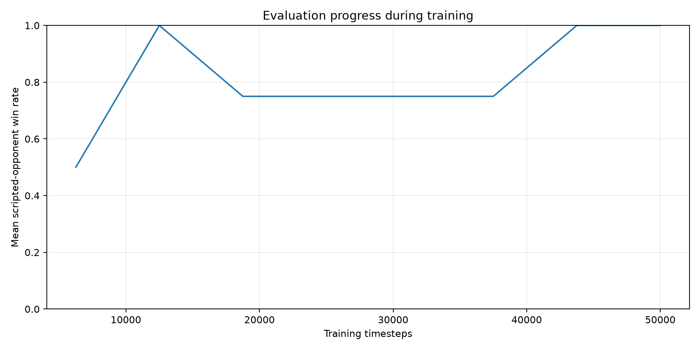
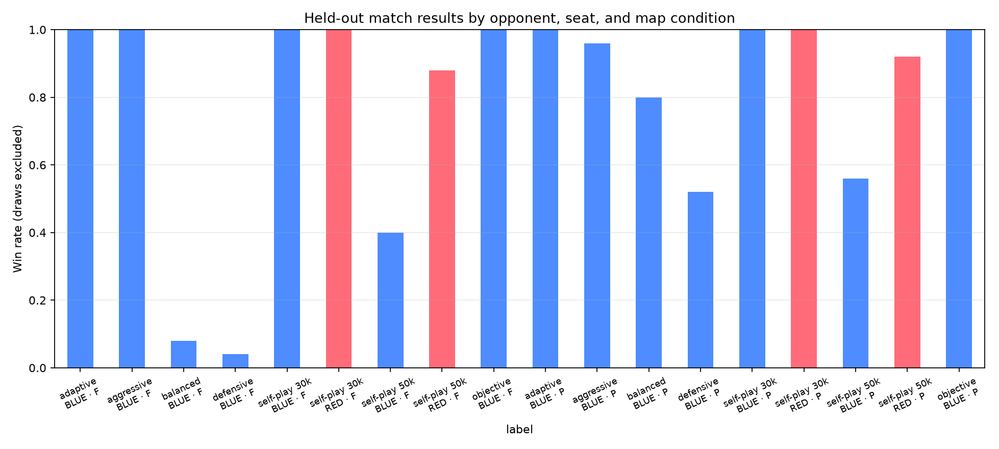

# MOBA-RL analysis report

## Training progress

The source contains 8 checkpoints and 1–1 evaluation episode(s) per opponent per checkpoint. Treat the curve as a progress trace, not a precise estimate of final win rate or training-seed variance.

Across these benchmark inputs, the candidate captured the neutral objective in 0/450 matches; its wins came through other simulator outcomes, chiefly structure destruction.

## Match benchmark evidence

These are deterministic policy evaluations over fixed seeds. Wilson intervals use decisive games; draws are reported separately. Scripted opponents are evaluated with the candidate in Blue, while learned historical opponents are evaluated with the candidate in both seats. The adaptive baseline is held out: the saved training code lists aggressive, defensive, objective, and balanced as its scripted training opponents.

| Map | Opponent | Type | Candidate seat | Games | W-D-L | Win rate (95% CI) | Mean objectives | Mean towers destroyed | Mean action diversity |
|---|---|---|---|---:|---:|---:|---:|---:|---:|
| fixed | adaptive | scripted | blue | 25 | 25-0-0 | 100.0% (86.7%–100.0%) | 0.00 | 1.52 | 5.24 |
| fixed | aggressive | scripted | blue | 25 | 25-0-0 | 100.0% (86.7%–100.0%) | 0.00 | 1.00 | 5.96 |
| fixed | balanced | scripted | blue | 25 | 2-0-23 | 8.0% (2.2%–25.0%) | 0.00 | 2.52 | 5.96 |
| fixed | defensive | scripted | blue | 25 | 1-0-24 | 4.0% (0.7%–19.5%) | 0.00 | 2.92 | 5.04 |
| fixed | models/opponent_pool/moba_advanced_big_20261023/opponent_000030000.zip | policy | blue | 25 | 25-0-0 | 100.0% (86.7%–100.0%) | 0.00 | 1.00 | 4.00 |
| fixed | models/opponent_pool/moba_advanced_big_20261023/opponent_000030000.zip | policy | red | 25 | 25-0-0 | 100.0% (86.7%–100.0%) | 0.00 | 1.00 | 4.00 |
| fixed | models/opponent_pool/moba_advanced_big_20261023/opponent_000050000.zip | policy | blue | 25 | 10-0-15 | 40.0% (23.4%–59.3%) | 0.00 | 1.00 | 4.00 |
| fixed | models/opponent_pool/moba_advanced_big_20261023/opponent_000050000.zip | policy | red | 25 | 22-0-3 | 88.0% (70.0%–95.8%) | 0.00 | 1.00 | 4.00 |
| fixed | objective | scripted | blue | 25 | 25-0-0 | 100.0% (86.7%–100.0%) | 0.00 | 1.52 | 5.24 |
| procedural | adaptive | scripted | blue | 25 | 25-0-0 | 100.0% (86.7%–100.0%) | 0.00 | 1.88 | 5.64 |
| procedural | aggressive | scripted | blue | 25 | 24-0-1 | 96.0% (80.5%–99.3%) | 0.00 | 1.60 | 5.36 |
| procedural | balanced | scripted | blue | 25 | 20-0-5 | 80.0% (60.9%–91.1%) | 0.00 | 2.24 | 5.32 |
| procedural | defensive | scripted | blue | 25 | 13-0-12 | 52.0% (33.5%–70.0%) | 0.00 | 2.68 | 5.52 |
| procedural | models/opponent_pool/moba_advanced_big_20261023/opponent_000030000.zip | policy | blue | 25 | 25-0-0 | 100.0% (86.7%–100.0%) | 0.00 | 1.08 | 4.04 |
| procedural | models/opponent_pool/moba_advanced_big_20261023/opponent_000030000.zip | policy | red | 25 | 25-0-0 | 100.0% (86.7%–100.0%) | 0.00 | 1.00 | 4.04 |
| procedural | models/opponent_pool/moba_advanced_big_20261023/opponent_000050000.zip | policy | blue | 25 | 14-0-11 | 56.0% (37.1%–73.3%) | 0.00 | 1.76 | 4.16 |
| procedural | models/opponent_pool/moba_advanced_big_20261023/opponent_000050000.zip | policy | red | 25 | 23-0-2 | 92.0% (75.0%–97.8%) | 0.00 | 1.08 | 4.04 |
| procedural | objective | scripted | blue | 25 | 25-0-0 | 100.0% (86.7%–100.0%) | 0.00 | 1.88 | 5.64 |

The matched map comparison is in `paired_map_comparison.csv`. It compares fixed and procedural outcomes on the overlapping seed IDs and reports the paired mean score difference (win=1, draw=0.5, loss=0); it is descriptive and does not adjust for multiple opponents.

Interpretation limits: these results describe the tested checkpoint and simulator settings, not human-level play. Historical policy snapshots are from the same training lineage, so they are useful self-play opponents but not independent external policies. The benchmark records objective captures and structure damage to expose wins that come from a narrow strategy.
