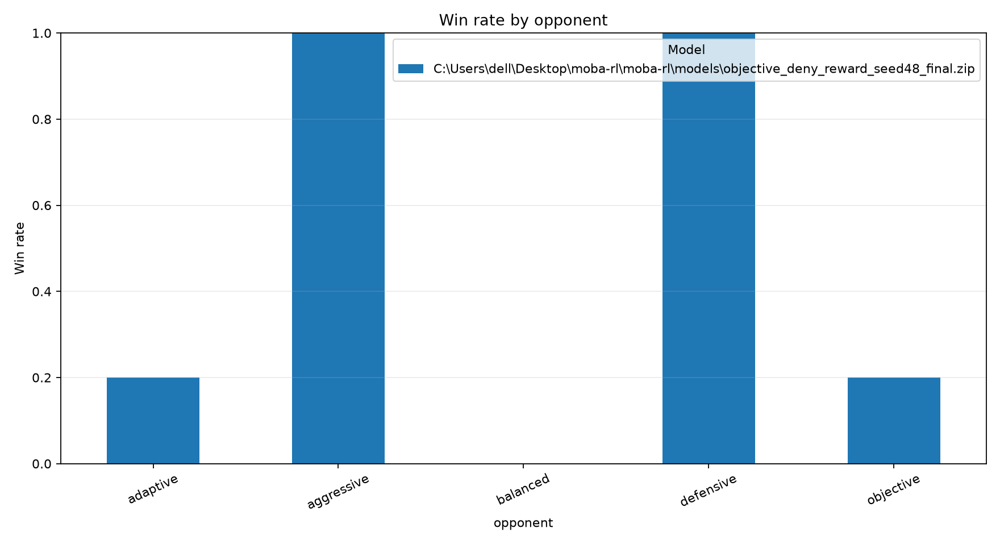

# MOBA-RL analysis report

## Evaluation summary

| model                                                                               | opponent   |   episodes |   wins |   losses |   draws |   mean_episode_length |   mean_episode_reward |   win_rate |
|:------------------------------------------------------------------------------------|:-----------|-----------:|-------:|---------:|--------:|----------------------:|----------------------:|-----------:|
| .\models\objective_deny_reward_seed48_final.zip | adaptive   |          5 |      1 |        4 |       0 |                1369   |               13.0737 |        0.2 |
| .\models\objective_deny_reward_seed48_final.zip | aggressive |          5 |      5 |        0 |       0 |                1403.6 |               68.1291 |        1   |
| .\models\objective_deny_reward_seed48_final.zip | balanced   |          5 |      0 |        5 |       0 |                1236   |               19.6675 |        0   |
| .\models\objective_deny_reward_seed48_final.zip | defensive  |          5 |      5 |        0 |       0 |                1337.2 |               38.2229 |        1   |
| .\models\objective_deny_reward_seed48_final.zip | objective  |          5 |      1 |        4 |       0 |                1363   |               12.7749 |        0.2 |

## Replay summary

| file                                    | opponent   | winner   |   episode_seed |   steps |   event_count |   objective_captures |   blue_objective_captures |   red_objective_captures |
|:----------------------------------------|:-----------|:---------|---------------:|--------:|--------------:|---------------------:|--------------------------:|-------------------------:|
| adaptive_episode_0000_seed_120000.json  | adaptive   | red      |         120000 |    1369 |           919 |                    1 |                         0 |                        1 |
| adaptive_episode_0001_seed_120001.json  | adaptive   | red      |         120001 |    1364 |           931 |                    1 |                         0 |                        1 |
| adaptive_episode_0002_seed_120002.json  | adaptive   | red      |         120002 |    1364 |           932 |                    1 |                         0 |                        1 |
| adaptive_episode_0003_seed_120003.json  | adaptive   | blue     |         120003 |    1384 |           938 |                    1 |                         0 |                        1 |
| adaptive_episode_0004_seed_120004.json  | adaptive   | red      |         120004 |    1364 |           914 |                    1 |                         0 |                        1 |
| aggressive_episode_0000_seed_80000.json | aggressive | blue     |          80000 |    1419 |           767 |                    0 |                         0 |                        0 |
| aggressive_episode_0001_seed_80001.json | aggressive | blue     |          80001 |    1424 |           797 |                    0 |                         0 |                        0 |
| aggressive_episode_0002_seed_80002.json | aggressive | blue     |          80002 |    1389 |           845 |                    0 |                         0 |                        0 |
| aggressive_episode_0003_seed_80003.json | aggressive | blue     |          80003 |    1394 |           812 |                    0 |                         0 |                        0 |
| aggressive_episode_0004_seed_80004.json | aggressive | blue     |          80004 |    1392 |           738 |                    0 |                         0 |                        0 |
| balanced_episode_0000_seed_110000.json  | balanced   | red      |         110000 |    1254 |           891 |                    0 |                         0 |                        0 |
| balanced_episode_0001_seed_110001.json  | balanced   | red      |         110001 |    1229 |           844 |                    0 |                         0 |                        0 |
| balanced_episode_0002_seed_110002.json  | balanced   | red      |         110002 |    1229 |           834 |                    0 |                         0 |                        0 |
| balanced_episode_0003_seed_110003.json  | balanced   | red      |         110003 |    1229 |           831 |                    0 |                         0 |                        0 |
| balanced_episode_0004_seed_110004.json  | balanced   | red      |         110004 |    1239 |           868 |                    0 |                         0 |                        0 |
| defensive_episode_0000_seed_90000.json  | defensive  | blue     |          90000 |    1327 |           664 |                    0 |                         0 |                        0 |
| defensive_episode_0001_seed_90001.json  | defensive  | blue     |          90001 |    1324 |           665 |                    0 |                         0 |                        0 |
| defensive_episode_0002_seed_90002.json  | defensive  | blue     |          90002 |    1354 |           671 |                    0 |                         0 |                        0 |
| defensive_episode_0003_seed_90003.json  | defensive  | blue     |          90003 |    1352 |           668 |                    0 |                         0 |                        0 |
| defensive_episode_0004_seed_90004.json  | defensive  | blue     |          90004 |    1329 |           651 |                    0 |                         0 |                        0 |
| objective_episode_0000_seed_100000.json | objective  | blue     |         100000 |    1364 |           944 |                    1 |                         0 |                        1 |
| objective_episode_0001_seed_100001.json | objective  | red      |         100001 |    1364 |           917 |                    1 |                         0 |                        1 |
| objective_episode_0002_seed_100002.json | objective  | red      |         100002 |    1362 |           907 |                    1 |                         0 |                        1 |
| objective_episode_0003_seed_100003.json | objective  | red      |         100003 |    1363 |           914 |                    1 |                         0 |                        1 |
| objective_episode_0004_seed_100004.json | objective  | red      |         100004 |    1362 |           913 |                    1 |                         0 |                        1 |

Action counts are also saved to `replay_action_counts.csv`.
