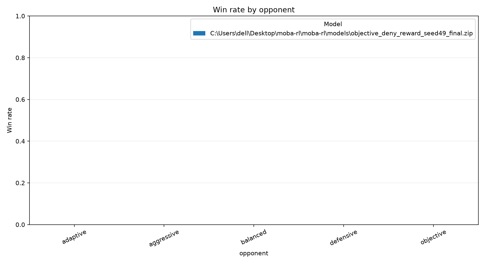

# MOBA-RL analysis report

## Evaluation summary

| model                                                                               | opponent   |   episodes |   wins |   losses |   draws |   mean_episode_length |   mean_episode_reward |   win_rate |
|:------------------------------------------------------------------------------------|:-----------|-----------:|-------:|---------:|--------:|----------------------:|----------------------:|-----------:|
| .\models\objective_deny_reward_seed49_final.zip | adaptive   |          2 |      0 |        2 |       0 |                1229   |             -4.21453  |          0 |
| .\models\objective_deny_reward_seed49_final.zip | aggressive |          2 |      0 |        2 |       0 |                1563   |             34.7898   |          0 |
| .\models\objective_deny_reward_seed49_final.zip | balanced   |          2 |      0 |        2 |       0 |                1134   |              0.533087 |          0 |
| .\models\objective_deny_reward_seed49_final.zip | defensive  |          2 |      0 |        2 |       0 |                1620.5 |              2.32084  |          0 |
| .\models\objective_deny_reward_seed49_final.zip | objective  |          2 |      0 |        2 |       0 |                1236   |             -4.23148  |          0 |

## Replay summary

| file                                     | opponent   | winner   |   episode_seed |   steps |   event_count |   objective_captures |   blue_objective_captures |   red_objective_captures |
|:-----------------------------------------|:-----------|:---------|---------------:|--------:|--------------:|---------------------:|--------------------------:|-------------------------:|
| adaptive_episode_0000_seed_140000.json   | adaptive   | red      |         140000 |    1229 |           615 |                    1 |                         0 |                        1 |
| adaptive_episode_0001_seed_140001.json   | adaptive   | red      |         140001 |    1229 |           590 |                    1 |                         0 |                        1 |
| aggressive_episode_0000_seed_100000.json | aggressive | red      |         100000 |    1564 |           788 |                    0 |                         0 |                        0 |
| aggressive_episode_0001_seed_100001.json | aggressive | red      |         100001 |    1562 |           825 |                    0 |                         0 |                        0 |
| balanced_episode_0000_seed_130000.json   | balanced   | red      |         130000 |    1144 |           440 |                    0 |                         0 |                        0 |
| balanced_episode_0001_seed_130001.json   | balanced   | red      |         130001 |    1124 |           437 |                    0 |                         0 |                        0 |
| defensive_episode_0000_seed_110000.json  | defensive  | red      |         110000 |    1627 |           854 |                    0 |                         0 |                        0 |
| defensive_episode_0001_seed_110001.json  | defensive  | red      |         110001 |    1614 |           814 |                    0 |                         0 |                        0 |
| objective_episode_0000_seed_120000.json  | objective  | red      |         120000 |    1242 |           617 |                    1 |                         0 |                        1 |
| objective_episode_0001_seed_120001.json  | objective  | red      |         120001 |    1230 |           606 |                    1 |                         0 |                        1 |

Action counts are also saved to `replay_action_counts.csv`.
