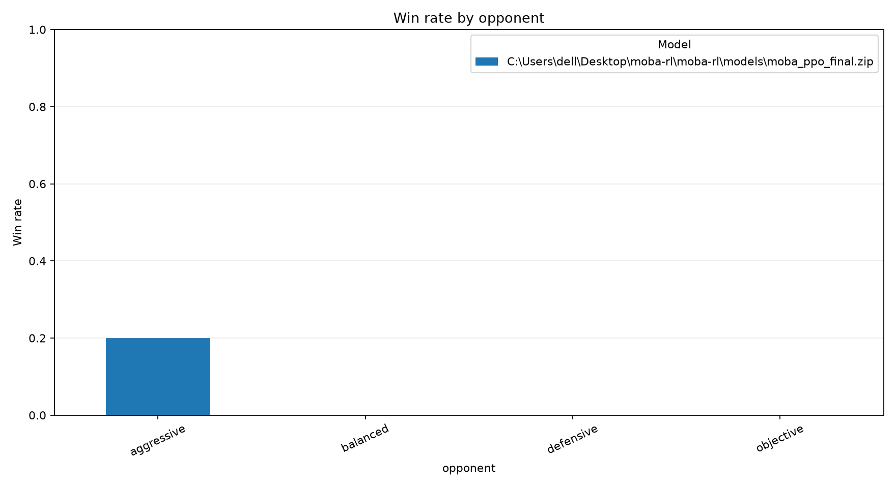
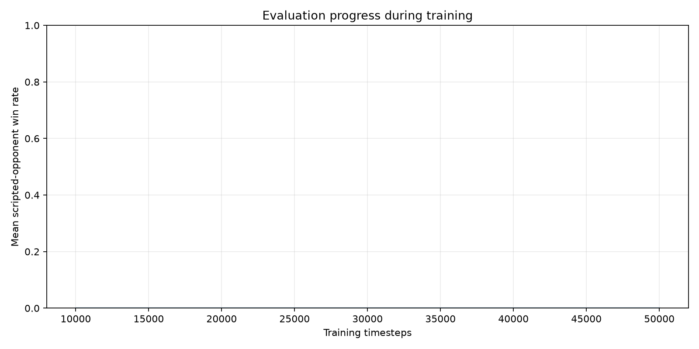

# MOBA-RL analysis report

## Evaluation summary

| model                                                           | opponent   |   episodes |   wins |   losses |   draws |   mean_episode_length |   mean_episode_reward |   win_rate |
|:----------------------------------------------------------------|:-----------|-----------:|-------:|---------:|--------:|----------------------:|----------------------:|-----------:|
| .\models\moba_ppo_final.zip | aggressive |         20 |      4 |       16 |       0 |               1656.95 |               5.21945 |        0.2 |
| .\models\moba_ppo_final.zip | balanced   |         20 |      0 |       20 |       0 |               1012    |              -8.688   |        0   |
| .\models\moba_ppo_final.zip | defensive  |         20 |      0 |       20 |       0 |               1627.55 |              -5.30245 |        0   |
| .\models\moba_ppo_final.zip | objective  |         20 |      0 |       20 |       0 |               1181.35 |              -7.31865 |        0   |

## Training progress

## Replay summary

| file                                   | opponent   | winner   |   episode_seed |   steps |   event_count |   objective_captures |
|:---------------------------------------|:-----------|:---------|---------------:|--------:|--------------:|---------------------:|
| aggressive_episode_0000_seed_7000.json | aggressive | red      |           7000 |    1461 |           736 |                    0 |
| balanced_episode_0000_seed_37000.json  | balanced   | red      |          37000 |    1156 |           533 |                    0 |
| defensive_episode_0000_seed_17000.json | defensive  | red      |          17000 |    1714 |           884 |                    0 |
| objective_episode_0000_seed_27000.json | objective  | red      |          27000 |    1199 |           554 |                    1 |

Action counts are also saved to `replay_action_counts.csv`.
