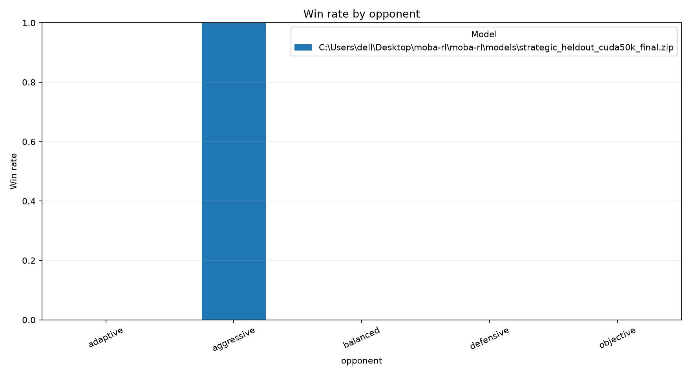
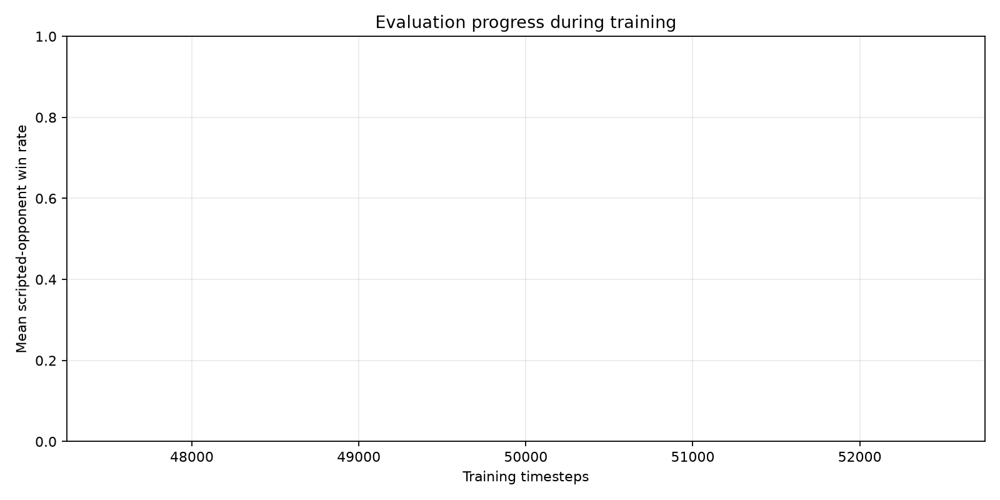

# MOBA-RL analysis report

## Evaluation summary

| model                                                                            | opponent   |   episodes |   wins |   losses |   draws |   mean_episode_length |   mean_episode_reward |   win_rate |
|:---------------------------------------------------------------------------------|:-----------|-----------:|-------:|---------:|--------:|----------------------:|----------------------:|-----------:|
| .\models\strategic_heldout_cuda50k_final.zip | adaptive   |          5 |      0 |        5 |       0 |                1285   |               -6.195  |          0 |
| .\models\strategic_heldout_cuda50k_final.zip | aggressive |          5 |      5 |        0 |       0 |                1626.4 |               16.5644 |          1 |
| .\models\strategic_heldout_cuda50k_final.zip | balanced   |          5 |      0 |        5 |       0 |                1199.2 |               -6.4608 |          0 |
| .\models\strategic_heldout_cuda50k_final.zip | defensive  |          5 |      0 |        5 |       0 |                1643.4 |               -4.8366 |          0 |
| .\models\strategic_heldout_cuda50k_final.zip | objective  |          5 |      0 |        5 |       0 |                1271.6 |               -6.3288 |          0 |

## Training progress

## Replay summary

| file                                    | opponent   | winner   |   episode_seed |   steps |   event_count |   objective_captures |
|:----------------------------------------|:-----------|:---------|---------------:|--------:|--------------:|---------------------:|
| adaptive_episode_0000_seed_90000.json   | adaptive   | red      |          90000 |    1288 |           732 |                    1 |
| adaptive_episode_0001_seed_90001.json   | adaptive   | red      |          90001 |    1235 |           567 |                    1 |
| adaptive_episode_0002_seed_90002.json   | adaptive   | red      |          90002 |    1300 |           700 |                    1 |
| adaptive_episode_0003_seed_90003.json   | adaptive   | red      |          90003 |    1327 |           634 |                    1 |
| adaptive_episode_0004_seed_90004.json   | adaptive   | red      |          90004 |    1275 |           674 |                    1 |
| aggressive_episode_0000_seed_50000.json | aggressive | blue     |          50000 |    1494 |           820 |                    0 |
| aggressive_episode_0001_seed_50001.json | aggressive | blue     |          50001 |    1641 |           741 |                    0 |
| aggressive_episode_0002_seed_50002.json | aggressive | blue     |          50002 |    1745 |           985 |                    0 |
| aggressive_episode_0003_seed_50003.json | aggressive | blue     |          50003 |    1637 |           732 |                    0 |
| aggressive_episode_0004_seed_50004.json | aggressive | blue     |          50004 |    1615 |           749 |                    0 |
| balanced_episode_0000_seed_80000.json   | balanced   | red      |          80000 |    1220 |           541 |                    0 |
| balanced_episode_0001_seed_80001.json   | balanced   | red      |          80001 |    1183 |           498 |                    0 |
| balanced_episode_0002_seed_80002.json   | balanced   | red      |          80002 |    1207 |           449 |                    0 |
| balanced_episode_0003_seed_80003.json   | balanced   | red      |          80003 |    1177 |           480 |                    0 |
| balanced_episode_0004_seed_80004.json   | balanced   | red      |          80004 |    1209 |           470 |                    0 |
| defensive_episode_0000_seed_60000.json  | defensive  | red      |          60000 |    1581 |           917 |                    0 |
| defensive_episode_0001_seed_60001.json  | defensive  | red      |          60001 |    1707 |           870 |                    0 |
| defensive_episode_0002_seed_60002.json  | defensive  | red      |          60002 |    1714 |           881 |                    0 |
| defensive_episode_0003_seed_60003.json  | defensive  | red      |          60003 |    1596 |           810 |                    0 |
| defensive_episode_0004_seed_60004.json  | defensive  | red      |          60004 |    1619 |           759 |                    0 |
| objective_episode_0000_seed_70000.json  | objective  | red      |          70000 |    1294 |           742 |                    1 |
| objective_episode_0001_seed_70001.json  | objective  | red      |          70001 |    1284 |           658 |                    1 |
| objective_episode_0002_seed_70002.json  | objective  | red      |          70002 |    1260 |           580 |                    1 |
| objective_episode_0003_seed_70003.json  | objective  | red      |          70003 |    1254 |           657 |                    1 |
| objective_episode_0004_seed_70004.json  | objective  | red      |          70004 |    1266 |           593 |                    1 |

Action counts are also saved to `replay_action_counts.csv`.
