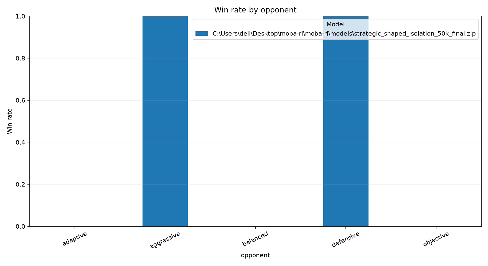

# MOBA-RL analysis report

## Evaluation summary

| model                                                                                 | opponent   |   episodes |   wins |   losses |   draws |   mean_episode_length |   mean_episode_reward |   win_rate |
|:--------------------------------------------------------------------------------------|:-----------|-----------:|-------:|---------:|--------:|----------------------:|----------------------:|-----------:|
| .\models\strategic_shaped_isolation_50k_final.zip | adaptive   |          5 |      0 |        5 |       0 |                1242   |               4.31711 |          0 |
| .\models\strategic_shaped_isolation_50k_final.zip | aggressive |          5 |      5 |        0 |       0 |                1509.4 |              71.6804  |          1 |
| .\models\strategic_shaped_isolation_50k_final.zip | balanced   |          5 |      0 |        5 |       0 |                1124   |               2.45411 |          0 |
| .\models\strategic_shaped_isolation_50k_final.zip | defensive  |          5 |      5 |        0 |       0 |                1549.6 |              31.4447  |          1 |
| .\models\strategic_shaped_isolation_50k_final.zip | objective  |          5 |      0 |        5 |       0 |                1244   |               3.31911 |          0 |

